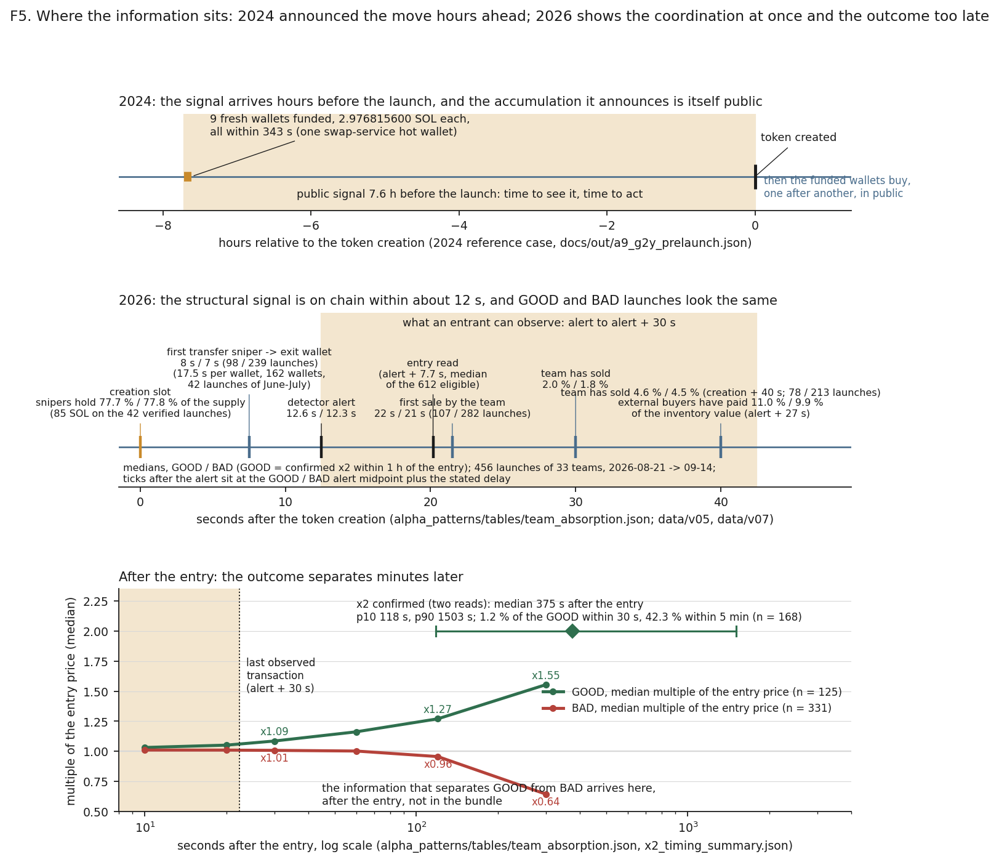

# Why Solana Memecoins Are Over

Between **October and December 2024**, I withdrew **$237,137.87** trading memecoins on **pump.fun**.

I had started with roughly **$400**, a multiple of about **590×**.

I stopped when the pattern I was exploiting disappeared.

Not because the market had become impossible to read.

Because the mechanism had changed.

So I did what I had been doing from the beginning: I went back to the chain and looked for what replaced it.

This repository is the result.

It is part trading history, part on-chain investigation, and part attempt to prove myself wrong.

---

## What this repository demonstrates

This is not a tutorial and it is not a collection of screenshots.

It is a reproducible blockchain investigation built from transaction-level data.

The work covers:

* **Blockchain forensics**
* **On-chain transaction tracing and attribution discipline**
* **Wallet clustering and relationship analysis**
* **Funding-flow reconstruction**
* **Pattern and anomaly detection**
* **Detection of coordinated accumulation**
* **Real-time transaction monitoring**
* **Hypothesis testing and falsification**
* **Manual transaction verification**
* **Detection of instrumentation and data-quality failures**
* **Python-based data analysis**
* **Reproducible research**
* **On-chain financial-flow reconstruction**
* **Pre-registered hypothesis testing on a live detector's alerts**

The central question was simple:

> **What changed in the way successful Solana memecoins were accumulated, and could that change be measured directly on-chain?**

---

# Disclosure

The pattern documented below is one I identified and traded myself, lawfully, under my own name.

Starting capital was roughly **$400**; withdrawals over October–December 2024 came to **$237,137.87**, a multiple of roughly **590×**.

The withdrawal figure is reconstructed directly from the blockchain by `code/expl_ledger.py` and reproduces from the committed artefacts.

The starting capital is different: it is a Phase-0 recollection from before the measured window and is explicitly marked as unsourced. The 590× figure is therefore arithmetic based on those two numbers and inherits the same limitation.

I consider that distinction important.

Where this repository can measure something, I measure it.

Where it cannot, I say so.

When the trading stopped, I turned the same methodology against my own claims. `docs/PITFALLS.md` documents fifteen competing explanations that were tested, corrected or retired. Results that could not be regenerated from the published data were deleted rather than kept.

That standard is intentional.

---

# Abstract

In 2024, some of the Solana memecoins that performed strongly followed a surprisingly repeatable accumulation pattern.

Fresh wallets appeared shortly before a token launch.

They were funded through **ChangeNOW**.

They accumulated meaningful portions of supply shortly after launch.

And because the accumulation happened publicly, somebody watching the chain closely could detect it early enough to participate.

I did.

The interesting part came later.

The wallets multiplied.

The funding pattern disappeared.

The public signal became harder to observe.

So I rebuilt the investigation from the blockchain and measured what changed.

Then I asked the question a trader would ask next: once the new mechanism is visible on chain, can it be traded?

Act IV is the answer. It is no, for a reason more precise than "the edge is gone".

The repository contains the data, scripts, validation procedures, competing hypotheses and transaction-level evidence behind that investigation.

---

# Act I — The 2024 Pattern

Before a pump.fun token existed, the wallets participating in it often already did.

Typically, they were:

* created the same day as the token
* funded through ChangeNOW
* holding nothing else
* buying immediately after launch
* accumulating meaningful percentages of supply

The funding trail led back to a single address:

`G2YxRa6wt1qePMwfJzdXZG62ej4qaTC7YURzuh2Lwd3t`

a hot wallet attributed externally to the swap service **ChangeNOW**.[1]

ChangeNOW broke the direct on-chain trail.

The wallets therefore appeared unrelated.

They weren't.

The signal was in the funding behaviour.

Large SOL transfers reached multiple fresh wallets in **identical amounts, down to nine decimal places**.

One example:

* **9 wallets**
* all created that morning
* all funded with exactly **2.976815600 SOL**
* all funded within **343 seconds**
* token launched **7.6 hours later**

The interesting question was no longer:

> "Who is buying this token?"

It was:

> **"Why were these wallets funded in this exact configuration before the token even existed?"**

Once one wallet bought roughly **2% of supply** — around 20 million tokens — the others frequently followed.

That created something unusual in an otherwise chaotic market:

**a measurable, observable accumulation pattern.**

---

# Exploiting the Pattern

Once I understood the pattern, I traded it.

The configuration I looked for was specific:

> A ChangeNOW-funded wallet buying at least **2% of supply** on a fresh pump.fun launch.

When that happened, I bought too — **1% of supply at most**, deliberately small enough not to become part of the signal.

The thesis was simple:

If the first wallet was part of a coordinated accumulation, the remaining wallets should follow.

The chain became the order-flow signal.

I did not need to know who controlled the wallets.

I needed to observe what they repeatedly did.

After every large gain, I moved to a fresh wallet. The objective was to avoid becoming another visible participant in the pattern I was exploiting.

The position was then managed from the operators' own behaviour: accumulation, curve shape, subsequent buying and eventual exhaustion.

The important point for this investigation is not the trading strategy itself.

It is that **the strategy depended on information being publicly observable on-chain.**

And eventually, that information stopped being observable.

---

# Results

The results below are reconstructed from the blockchain, from the deposit address's own balance changes.

| Metric                                     |             Result |
| ------------------------------------------ | -----------------: |
| Withdrawn, Oct–Dec 2024                    | **1,190.6957 SOL** |
| USD value at each transfer's own day price |    **$237,137.87** |
| Incoming transfers, Oct–Dec 2024           |            **245** |
| Distinct sending wallets                   |             **74** |
| Example trades in documented sample        |             **19** |
| Full window through 2 Feb 2025             |    **$244,315.58** |

The money rows are the strongest measurements.

Each transfer is valued using the SOL close of its own UTC day rather than a single average price.

The ledger also closes internally:

**1,226.4663 SOL** arrived over the full window against **1,226.4566 SOL** swept out to the exchange.

The transfer and wallet counts are more method-dependent. A transfer represents a successful transaction carrying a positive balance delta, while the sending wallet is attributed using the largest opposing delta in that transaction.

Those definitions are documented rather than hidden.

---

# The evidence is public

The deposit address used for the reconstruction is published:

`6tmiM84AxMzmXzRByq7m1dgNkHtn9wp671e1GMe2ZmWU`

It is my KYC'd exchange deposit address.

Publishing it was deliberate.

It means the central financial result does not depend on trusting a screenshot or trusting me.

Anyone can query the address on-chain and reproduce the ledger.

The reconstruction is:

`code/expl_ledger.py` → `docs/out/expl_ledger.json`

The 74 sending wallets are published as a count rather than as a curated identity list. Where the methodology cannot establish ownership, the repository does not claim ownership.

For example, four of the 74 are resolved by the same methodology as third-party exchange infrastructure and are therefore recorded as `NON_ETABLI` rather than assigned to an individual.

That distinction matters in blockchain investigations:

**transactional relationship is evidence; ownership attribution requires additional evidence.**

---

# Act II — Closing the Leak

That was the trade from my side.

From the operators' side, the model had an obvious weakness:

**it was observable.**

Funding happened hours before launch.

Accumulation happened slowly enough to detect.

The wallets became visible.

And anyone watching the chain could buy alongside them.

As the wallet inventory grew into the thousands, the original funding mechanism became less useful.

The public funding stage disappeared.

The question was no longer:

> "Can I detect the accumulation?"

It became:

> **"Can accumulation still be detected before the public gets there?"**

That is what led to the next investigation.

---

# Act III — What Replaced It

What replaced the previous pattern does not simply shorten the observation window.

**It removes it.**

The new mechanism I identified is what I call the **group snipe**:

instead of accumulating publicly after launch, a group purchases essentially the entire bonding curve in the token's creation slot itself.

The measurement was performed across **42/42 manually verified launches**, with each transaction checked individually.

The observed signature:

* approximately **85 SOL**
* approximately **79% of supply**
* purchased inside the token creation slot
* **zero public bonding-curve purchases beforehand**

I then tested the same signature on a **separate frozen sample** of 70 tokens reaching at least $500k market cap.

**58 of 70 (82.9%)** exhibited the same signature.

This separation between the discovery sample and the frozen sample is deliberate.

It prevents the measurement from simply becoming a collection of examples selected after seeing the result.

---

# Real-World Example

One instance is the launch associated with **ANSEM ("TheBlackBull")**:[2]

Mint:

`9cRCn9rGT8V2imeM2BaKs13yhMEais3ruM3rPvTGpump`

Created:

**2026-06-16 21:05:48 UTC**

Creation slot:

**426930467**

Using the same measurement scripts:

* **85.007 SOL** purchased in the creation slot
* **84.74 SOL** purchased by a single wallet
* only **two buyers**
* **sixteen signatures**
* no bonding-curve supply left for public buyers

More importantly, both wallets were already present in the repository's historical wallet catalogue before this token existed.

One was a repeat operator observed across multiple tokens.

The other was classified as shared infrastructure.

The alert triggered immediately after creation.

This is the point where the repository moves from historical analysis to something closer to **transaction monitoring**:

a behavioural signature can be defined, measured, and triggered on a new event.

---

# Act IV — The Signal Still Exists. The Edge Doesn't.

The detector described above ran live from 21 August 2026.

By 29 September it had alerted on **1,657 launches**.

Which raised the question anyone who traded Act I would ask next:

> **Once the group snipe is visible on chain, can it be traded?**

Nine pre-registered studies and one systematic search later, the answer, within what was tested, is no.

The reason is the interesting part.

## What was tried

Each study was written as a plan before its rates were computed, and ended with a verdict.

The studies that tested a signal read the alerts after 15 September as their hold-out, one after another.

| question | verdict |
|---|---|
| Does buying right after the alert still pay? | Statistical signal, no tradable edge (`post_detection_edge/`) |
| Does the bundle's on-chain structure say which launches double? | No robust separation (`post_detection_forensics/`, `entry_zone/`, `sniper_capital/`) |
| Do the buying wallets act as a group? | Yes, in about four launches out of five (`coordination_detection/`) |
| How does the group operate? | A repeatable loop: one funder, four snipers, 78 % of the supply, exit wallets, the capital back, the same snipers funded again a median 21 minutes later (18 in the validation weeks) (`economic_mechanics/`, `exit_destination/`, `funder_network/`) |
| Is "a group we have already seen" a live signal? | No incremental signal (`known_group_reentry/`) |
| Is there any rule at all, over 415 features? | No exploitable pattern found (`alpha_patterns/`) |
| Do the teams, their rhythm, or the absorption of their inventory predict the outcome? | No (`alpha_patterns/`, three mechanism studies) |

## The teams exist

On the **1,015 launches** before 15 September 2026, **612** had an observable one-hour outcome and **168 (27.5 %)** doubled from the entry price read 5 to 15 s after the alert (the declared trade buys at alert + 5 s).

Shared wallets, shared funders and identical ticket configurations confirm each other **47 to 212 times** above chance: the operators are real, recognisable identities.

**33 teams** have five or more observable launches; **19** have ten or more.

Their doubling rates differ a little more than chance would allow, from **0 % to 58 %**, and the difference survives the calendar day and the entry price (p = 0.0017 within the day).

## The same teams make GOOD and BAD

**28 of the 33 teams** have both.

A team's history does not predict its next launch: the rule that bets on teams with a strong record is right **3 times in 29**, against **44.1 %** for the launches it leaves aside.

The rhythm is real, one launch every **20.6 minutes** in the median inside a session, and it does not determine the outcome: 17 pre-registered tests, none passes.

Inside a team, **32 variables** measured before the alert (configuration, wallets, funders, tickets, synchronisation, concentration, rhythm, swarm, other teams, market) show no detectable separation: none passes the correction.

## Absorption comes too late

The last hypothesis was that a GOOD launch is one where outside demand absorbs the team's inventory.

Forty seconds after the creation, the team has sold **4.6 %** of what it holds on a GOOD launch and **4.5 %** on a BAD one (on the 78 GOOD and 213 BAD launches observed that long).

Outside buyers have paid for about one tenth of its value, on both: **11.0 %** on the GOOD launches and **9.9 %** on the BAD, 27 s after the alert.

The price of a GOOD launch is at **×1.09** thirty seconds after the entry and **×1.55** after five minutes; a BAD one at **×1.01** and **×0.64**.

The confirmed doubling arrives a **median 375 s** after the entry; **1.2 %** of the GOOD launches confirm it within 30 s.

Forty tests of demand at the moment of decision: none passes.

## Where the information moved



In 2024, in the reference case of Act I, the signal came **7.6 hours** before the launch, and the move it announced happened in public afterwards.

In 2026 the coordination is on chain in the creation slot itself, the detector alerts a median **12.6 s / 12.3 s** after the creation (GOOD / BAD launches), and the outcome is decided minutes later, inside the price.

The window in between is where an entrant has to decide, and it holds structure, not prediction.

## Structural signal, predictive signal

A structural signal says who is launching, and how.

A predictive signal says which launch will double.

This repository establishes the first and did not find the second.

> We found a strong structural signal of coordinated launch-time accumulation. The analyses performed did not establish that this signal, or anything else observable before the entry, was sufficient to predict which launches would subsequently produce the measured price outcome.

Every figure in this act is checked against its artefact by `code/p1_readme_check.py`. The full chapter, hypothesis by hypothesis, is `docs/ACT_IV.md`; the search itself is `alpha_patterns/`.

**Exploratory, not validated out of sample.** These analyses ran on the first 1,015 alerts. One pre-declared rule was read once on the following week and failed. The last week was never read.

---

# Why Solana Memecoins Are Over

The story of this repository is a single chain of questions.

1. In 2024 I had an observable edge: wallets funded hours before a launch, accumulating in public.
2. The mechanism changed, and the edge went with it.
3. I identified what replaced it: the group snipe, the whole curve bought in the creation slot, on **42/42** manually verified launches and **58 of 70 (82.9%)** of an independent frozen sample, approximately **79% of supply** on the 42 verified launches.
4. I then asked whether the new mechanism could itself become an edge.
5. I identified the teams and their structure.
6. I tried their rhythm.
7. I tried the configuration of their bundles.
8. I tried to tell their GOOD launches from their BAD ones.
9. I tried the absorption of their inventory by outside demand.
10. Nothing tested gave a signal early enough to act on.
11. That is the result: the market now reveals the coordination of a launch without revealing, early enough, whether it will succeed.

In 2024, outsiders could observe accumulation, and that observation was the opportunity.

By 2026 the same activity happens inside the creation slot, and what the public sees first is the market after it.

The information advantage did not just shrink.

It moved: from the funding, hours ahead of the launch, to the demand, minutes behind the entry.

The conclusion I can defend from the on-chain evidence is narrower:

> **The observable accumulation pattern that made the 2024 strategy possible was replaced by a launch-time mechanism whose coordination is observable, and whose outcome was not found to be predictable early enough to trade.**

The public wasn't simply outcompeted.

**The observable order flow changed, and the part of it that predicts moved out of reach.**

---

# What I Tried to Prove Wrong

A blockchain pattern is not interesting because it looks convincing.

It is interesting if it survives attempts to explain it away.

`docs/PITFALLS.md` contains fifteen competing explanations and the tests used against them.

Among the questions I forced the analysis to answer:

* Could exchange infrastructure create the apparent clustering?
* Could batched transactions distort the counts?
* Could unrelated wallets happen to receive identical funding?
* Could bots explain the synchronization?
* Could the observed wallets simply be infrastructure?
* Does temporal proximity actually establish coordination?
* Can wallet activity establish common ownership?
* Can the result be reproduced from frozen data?

Some hypotheses survived partially.

Some were rejected.

Some claims were narrowed.

Some measurements were removed.

That is part of the result.

---

# Methodology

The investigation is built around a simple principle:

> **Every important claim should be traceable to an artefact, a transaction, or an explicitly identified external source.**

The workflow is approximately:

```text
Raw on-chain data
        ↓
Transaction normalization
        ↓
Wallet identification
        ↓
Funding-flow reconstruction
        ↓
Wallet clustering
        ↓
Temporal / behavioural analysis
        ↓
Hypothesis testing
        ↓
Manual verification
        ↓
Reproducible result
```

The repository therefore separates:

**Measured facts**

from

**interpretations**

from

**external claims**

from

**unsourced historical recollections**.

That separation is intentional.

---

# Repository Structure

| Path                   | Description                                                                         |
| ---------------------- | ----------------------------------------------------------------------------------- |
| `docs/PITFALLS.md`     | Fifteen competing explanations, the tests designed to break them, and what survived |
| `docs/METHODOLOGY.md`  | Definitions, populations, validation protocol and declared limitations              |
| `docs/RESULTATS.md`    | Complete 2026 measurements with an English executive summary                        |
| `docs/PATTERN.md`      | Funding distributions token by token with detected bursts                           |
| `docs/EXPLOITATION.md` | Trading methodology, automation, receipts and on-chain totals                       |
| `docs/SPLIT_PHASE1.md` | 2024–2025 split analysis with controls and null models                              |
| `docs/ACT_IV.md`       | Act IV in full: the studies after the detector, hypothesis by hypothesis, every figure traced to an artefact |
| `docs/INVESTIGATION.md` | The investigation framework used throughout                                        |
| `alpha_patterns/`      | The exploratory pattern search of October 2026: plan, pre-registrations, reports, result JSON, scripts, test registry, audits |
| `post_detection_edge/` … `known_group_reentry/` | Nine pre-registered studies, run 29 September to 1 October 2026 on the detector's 1,657 alerts of 21 August to 29 September 2026, each with its plan and results |
| `code/`                | One script per measurement                                                          |
| `data/`                | Versioned derived datasets                                                          |
| `figures/`             | Figures regenerated from the analysis scripts (`code/f_figures_resultats.py`, `code/f_act_iv_timeline.py`) |

---

# Author

**Benjamin Da Cunha**

I published this investigation under my real name deliberately.

The commit history is authored under it.

The trading screenshots retain the `teamdacunha` referral handle.

The **$237,137.87** withdrawal figure is reconstructed from my own exchange deposit address.

The chain, the code, the artefacts and the person behind the investigation are therefore connected.

I am not presenting this repository as a generic software-engineering portfolio.

I am presenting it as evidence of a specific capability:

> **I find patterns in blockchain data, build hypotheses around them, try to break those hypotheses, and turn the surviving evidence into a reproducible investigation.**

That is the work I want to keep doing.

---

# Footnotes

1. A 2025 external study on Solana mixers observed funds routed through ChangeNOW arriving at the address used in this investigation. An earlier public attribution also associates the address with the service. The repository measures what leaves the address; it does not independently establish who operates it.

2. External sources document the ANSEM/Black Bull launch. The wallet measurements themselves come from this repository. Where a value is not measured by an artefact in this repository, it is explicitly marked as unsourced.
